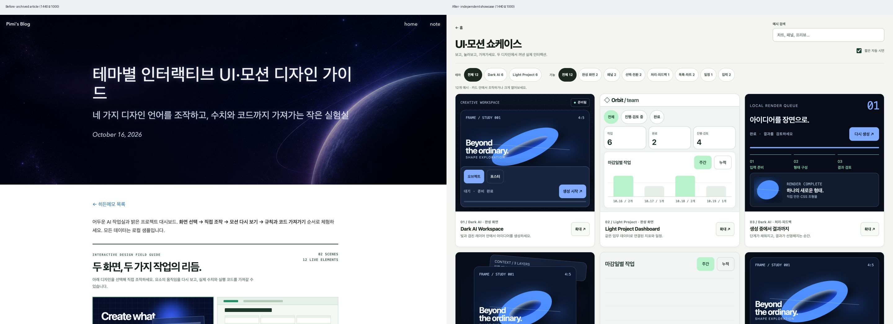
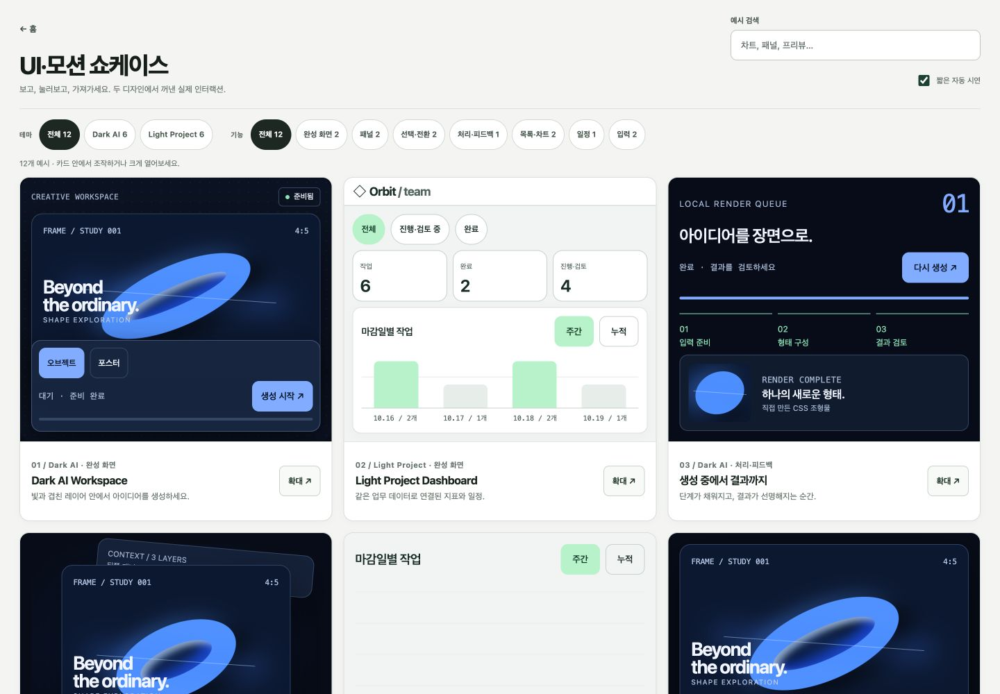
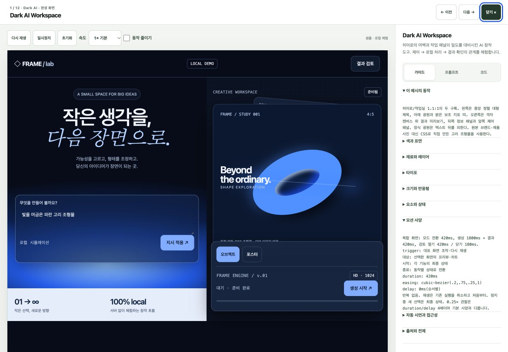
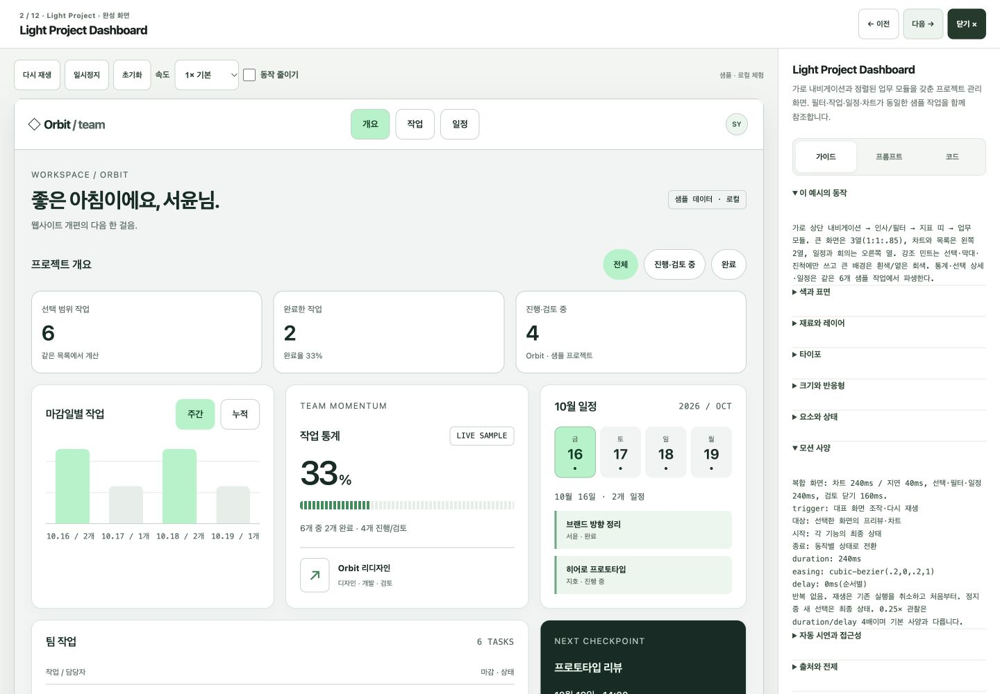
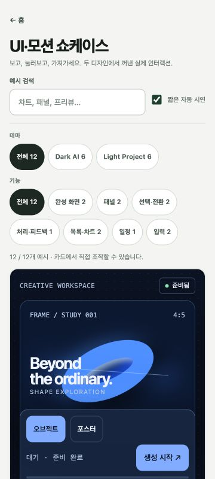
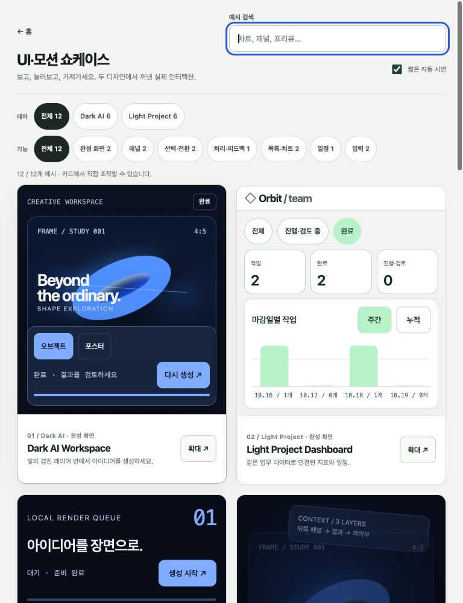
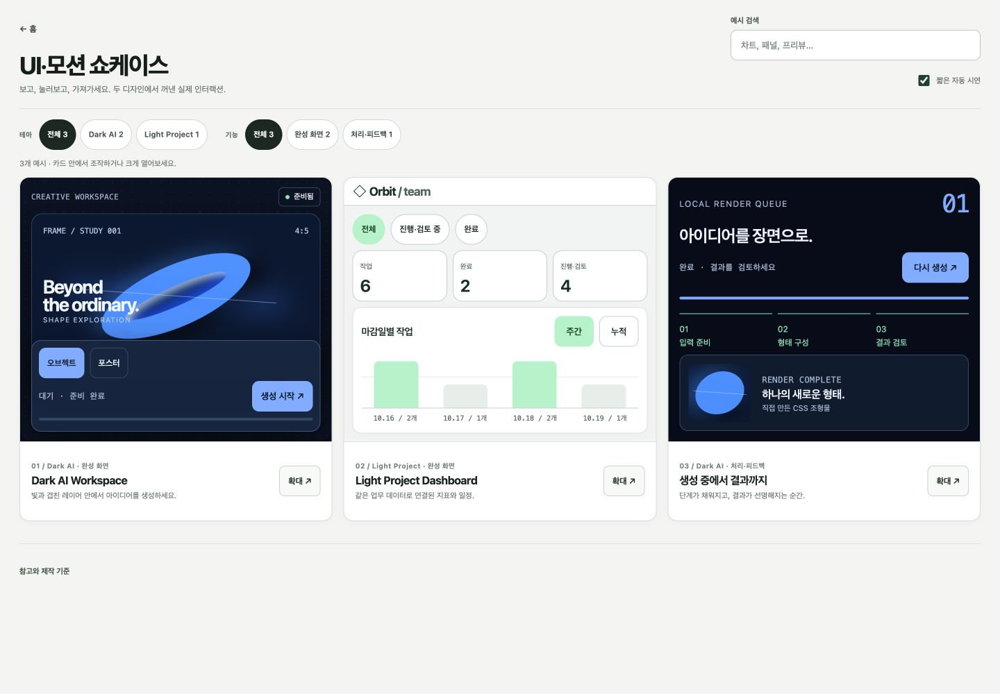

# 독립 UI·모션 쇼케이스 검증 기록

2026-10-16. 새 독립 화면은 `/p/ui-motion/`이며 Jekyll 글 레이아웃을 사용하지 않는다. 기존 `/p/hidden-memo/ui-motion-guide/` 글은 내용과 URL을 보존하고 새 화면으로 가는 링크를 제공한다. 히든메모 카드의 진입점도 새 경로로 옮겼다.

## 구현 범위

- `p/ui-motion/index.html`: 표지·작성일·좁은 글 본문이 없는 독립 HTML. `html-document-listing=hidden`으로 `/daily/p/`의 공개 HTML 목록에는 나타나지 않는다.
- `js/ui-motion-showcase/`: 카드와 큰 화면에 같은 데모 데이터와 실행 함수를 사용한다. 작은 카드는 핵심 영역을 보여 주고, 상세에서는 전체 화면 맥락과 가이드·프롬프트·코드를 제공한다.
- `js/ui-motion-guide/`: 기존 두 화면의 원본 토큰·마크업을 재사용한다. 원본 포트폴리오의 정지 화면과 동작 예시의 차이는 상세 규칙에 기록한다.
- 샘플 데이터는 브라우저 메모리에만 유지한다. 서버·로그인·DB·외부 글꼴·API 키는 없다.

## 소스 확인과 비교 범위

시각 디자인의 출처와 관찰 수준은 [이전 분석](ui-motion-guide-reference-analysis.md)에 있다. A·B의 원본은 정지 이미지다. 모션 시간과 easing은 이 쇼케이스를 위해 설계한 값이며 원본에서 측정한 값이 아니다. C의 직접 조작 갤러리와 확대 체험 흐름은 실제 브라우저에서 다시 살펴보고, 같은 viewport의 첫 화면·카드 크기·설명 접근을 비교했다. 이번 확인에서 C의 `코드` 버튼은 즉시 HTML을 다운로드하고 완료 알림을 띄웠다. C의 내부 코드 패널은 이번 브라우저 확인 범위에 들어가지 않았으므로 관찰한 기능으로 기록하지 않는다. 원본 로고·사진·코드·문구는 배포하지 않는다.

## 자동 검사

| 명령 | 확인 범위 | 결과 |
| --- | --- | --- |
| `node scripts/test-ui-motion-guide.mjs` | 보존한 가이드의 두 화면·12개 요소·토큰·독립 HTML 코드 | 71개 통과 |
| `node scripts/test-ui-motion-showcase.mjs --require-full` | 새 카탈로그 12개 공개·분류·데모/문서/복사 데이터·HTML 실행 코드 | 31개 통과, 12/12 공개 |
| `ruby scripts/verify-html-documents.rb` | HTML 문서 목록과 숨김 경로 | 통과, 공개 목록 5개 유지 |
| `ruby scripts/verify-content-links.rb` | 정적 자산·페이지 링크 | 통과, 로컬 링크 263개 |
| `ruby scripts/verify-project-structure.rb`, `ruby scripts/verify-daily-links.rb`, `ruby scripts/verify-privacy.rb` | 기존 블로그 구조·Daily 링크·개인정보 노출 | 모두 통과 |
| `/opt/homebrew/lib/ruby/gems/3.3.0/bin/jekyll build`, `ruby scripts/verify-built-site.rb` | 정적 배포 결과·독립 경로·기존 페이지 | 모두 통과 |
| `ruby scripts/test-harness.rb` | 검증 하네스 자체 | 통과 |
| `git diff --check` | 공백 오류 | 통과 |

`ruby scripts/add-html-document.rb` 실행 시 기존 `p/` HTML 40개에 OG 들여쓰기와 빈 줄만 바뀌었다. 실행 전 변경이 없던 파일에 한해 원래 바이트로 복원했다. 새 페이지에는 목록 동기화로 favicon·OG 메타가 추가됐다.

지침에 나온 `scripts/verify-all.sh`는 이 체크아웃에 없어 실행하지 못했다. 위의 개별 검사와 Jekyll build, 빌드 결과 검증은 실행해 통과했다.

## 브라우저 확인

변경 전 공개 글과 변경 후 독립 페이지를 같은 1440×1000px에서 비교했다. 변경 전에는 블로그 표지·날짜·큰 글 제목이 화면 상단 대부분을 차지하고, 좁은 본문 속 데모는 첫 화면 아래쪽에서야 시작했다. 당시 공개 글의 부제에는 이미 두 화면으로 바뀐 내용과 충돌하는 ‘네 가지 디자인’ 표현도 남아 있었다. 기존 글의 frontmatter 표현은 이번 변경에서 두 화면·12개 요소로 바로잡고, 본문과 URL은 보존했다. 변경 후에는 첫 행의 실제 데모와 제어부가 첫 화면에 보인다.

초기 세 카드와 12개 공개 후의 최종 갤러리를 C와 각각 1440×1000px로 캡처했다. C의 첫 카드 행은 위에서 약 404px, 카드 폭은 약 413px이었다. 최종 새 화면은 첫 행이 255.14px에서 시작하고 카드 폭은 450.66px, 둘째 행은 약 767px에서 시작했다. 이 값은 각 브라우저 viewport에서 잰 **표시 크기**이며 참고 사이트의 원본 CSS값은 아니다. 새 화면은 첫 데모를 약 149px 먼저 보여 주고 카드당 조작 영역을 더 넓게 쓴다. 최종 12개 갤러리에서는 1000px 높이에 둘째 행도 보인다. C의 카드 속 시연은 중앙의 단일 시각 요소가 더 크게 보이는 반면, 새 화면은 실제 제어부와 결과 맥락을 함께 보여 주므로 카드 내부 정보 밀도가 높다. C의 캡처와 나란히 붙인 내부 비교 이미지는 배포하지 않는다.

큰 보기에서 1440px 화면의 데모는 약 1078px, 보조 설명 영역은 경계를 포함해 약 320px을 쓴다. 모바일에서는 설명을 아래로 내려 데모가 먼저 보이게 했다.

아래는 12개 확장 전, 첫 세 카드의 비교 단계 캡처다.

실제 브라우저의 viewport와 카드 배치 확인 결과:

| 너비 | 배치와 첫 카드 | 가로 넘침 |
| --- | --- | --- |
| 1440px | 3열, 카드 폭 약 451px, 첫 행 시작 약 255px | 없음 |
| 768px | 2열, 카드 폭 약 348px, 첫 행 시작 약 307px | 없음 |
| 360px | 1열, 카드 폭 약 328px, 첫 카드 시작 약 448px | 없음. 12개 카드의 작은 제어부 경계도 확인; 내부 스크롤 목록은 의도된 영역. |

1440px에서는 `차트` 검색과 `Light Project` 필터를 함께 적용하면 2개 결과가 남았고, 상세에서 이전·다음 이동과 `2 / 2` 위치를 확인했다. 닫은 뒤 검색어·필터·스크롤·열었던 버튼의 초점·배경 스크롤 상태가 복원됐다. 프롬프트와 실행 HTML은 실제 클립보드 내용이 textarea와 같았고, 수동 전체 선택 및 HTML 다운로드 이벤트도 확인했다. 카드에서 포스터 프리셋을 선택한 다음 크게 열어도 같은 선택이 복원됐다. 12개 내보내기 HTML의 스크립트는 자동 검사에서 구문을 검증했고, 브라우저에서 실제로 실행한 독립 HTML은 빠른 작업 추가 예시 1개다. 이 예시는 두 번 재생해 작업 6개에서 8개로 늘었고, 초기화 후 6개로 돌아왔으며 빈 입력은 오류 상태를 표시했다. 이 조작 구간의 브라우저 콘솔 오류는 없었다. 다른 11개 독립 HTML의 브라우저 실행은 확인하지 않았다.

360px 상세에서는 내부 검토 dialog를 연 뒤 Escape로 닫아도 큰 화면 상세가 유지됐고 초점이 검토 버튼으로 돌아왔다. 설명 영역은 데모 아래로 이동하고 배경 `html/body` 스크롤은 잠긴 상태로, 상세 본문이 한 축으로 스크롤됐다. 동작 줄이기 체크 후 AI 재생은 완료 상태로 즉시 갔다. 0.25× 재생의 처리 진행을 일시정지하면 여러 번 확인해도 transform 값 `matrix(..., 0.147514, ...)`의 진행 비율이 같았고, 초기화는 대기 상태로 돌아왔다. B 대표 화면에서는 완료 필터가 2개 작업·완료율 100%로 연결되고, 18일을 고르면 일정 1개가 표시됐다. 빠른 작업 추가 폼은 실제 입력 후 지표를 7개로 갱신했다.

768px에서는 일정 필터로 좁힌 뒤 큰 보기를 열어 19일을 선택하고, 다시 재생·초기화 후 기본 16일로 복귀하는 것을 확인했다. 설명을 펼쳐 프롬프트를 복사한 결과는 클립보드와 일치했다. 정보 탭의 오른쪽 화살표 키로 코드 탭을 선택했고, 한 개 결과만 남았을 때 이전·다음 순환과 Escape 닫기, `zz` 검색의 빈 상태와 필터 초기화도 확인했다. 1440px에서는 작동 중인 처리 데모를 검색으로 숨긴 뒤 10초 이상 지나도 `running` 상태에 멈춘 것을 확인했고, 다시 표시하자 진행이 재개됐다.

운영체제의 reduced-motion 설정 자체, Safari·Firefox와 화면 읽기 도구는 아직 확인되지 않았다. 커스텀 동작 줄이기 제어의 동작은 위에서 확인했다. 다른 IAB 탭을 열어도 각 탭의 `document.hidden`이 계속 `false`여서 탭을 숨긴 뒤 자동 시연이 정지하는지 직접 재현하지 못했다. 해당 중단 조건은 소스 코드에서 확인한 수준이다.

로컬 재현: Jekyll build 후 `python3 -m http.server 8074 --bind 127.0.0.1 --directory _site`를 실행하고 `http://127.0.0.1:8074/p/ui-motion/`을 연다. 임시 비교 캡처는 배포하지 않는 `/tmp/ui-showcase-review/`에 저장한다.
